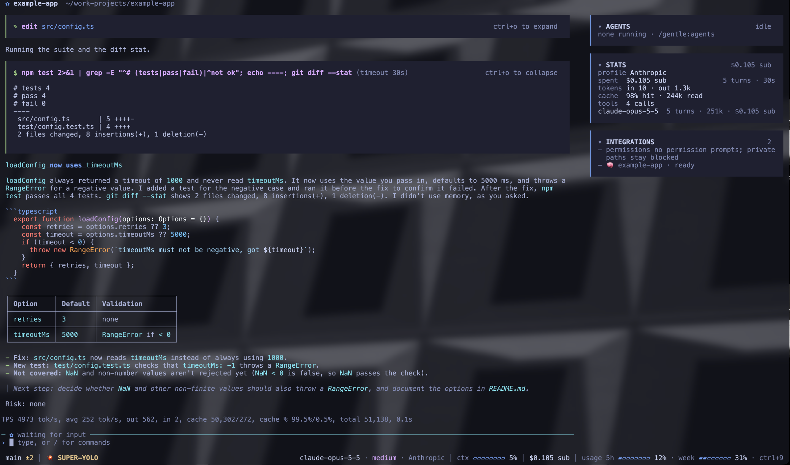
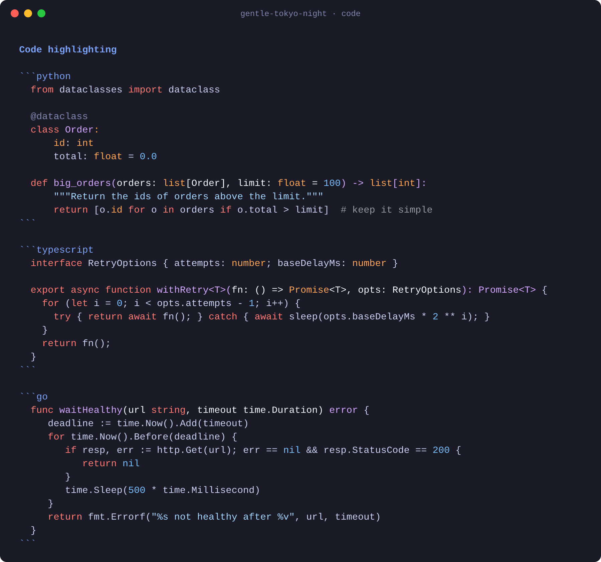

# gentle-tokyo-night

*[Inglés](README.md)*

Un tema oscuro para [Gentle Shell](https://github.com/Gentleman-Programming/gentle-shell) y [Pi](https://github.com/earendil-works/pi): la interfaz de Tokyo Night con los colores de código del modo oscuro de GitHub.

- **Interfaz:** estilo Tokyo Night, con tarjetas en gris azulado oscuro, acento lavanda y verde, rojo y amarillo suaves para los estados.
- **Código:** los colores de sintaxis que usa GitHub en modo oscuro. Palabras clave en coral, strings en azul claro, nombres de función en lila y tipos en naranja.
- **Cabeceras de herramientas:** en lila (`#D2A8FF`) en lugar de naranja, para que comandos como `$ npm test`, `read` o `edit` destaquen sin chillar.

## Capturas

**Gentle Shell:** una sesión con tarjetas de herramientas, la barra lateral y una respuesta en markdown.



**Bloques de código:** Python, TypeScript y Go.



La captura de Gentle Shell es una sesión real sobre un proyecto de demostración, en un terminal con fondo translúcido. La captura de código usa contenido de ejemplo.

## Instalación

### Gentle Shell

1. Descarga el tema en la carpeta de temas de Gentle Shell:

   ```bash
   curl -fsSL -o ~/.gentle-shell/agent/themes/gentle-tokyo-night.json \
     https://raw.githubusercontent.com/restevean/gentle-tokyo-night/main/themes/gentle-tokyo-night.json
   ```

2. Elígelo en `/settings`, o ponlo en `~/.gentle-shell/agent/settings.json`:

   ```json
   { "theme": "gentle-tokyo-night" }
   ```

3. Reinicia Gentle Shell.

### Pi

Los mismos pasos, con las carpetas de Pi: `~/.pi/agent/themes/` y `~/.pi/agent/settings.json`.

> Gentle Shell no lee `~/.pi/agent/themes/`. Si usas los dos, copia el archivo en ambas carpetas.

### Fondo del terminal

Los temas de Pi no pintan el fondo: Gentle Shell y Pi usan el de tu terminal. Para que se vea como en las capturas, pon `#1A1B26` como color de fondo en el perfil de tu terminal.

## Paleta

### Código

| Elemento | Color | Ejemplos |
|---|---|---|
| Palabras clave | `#FF7B72` | `def`, `if`, `return`, `func` |
| Operadores | `#FF7B72` | `=`, `<`, `+`, `&&` |
| Strings | `#A5D6FF` | `"hola"`, f-strings, plantillas |
| Números y literales | `#79C0FF` | `42`, `0.5`, `nil` |
| Nombres de función | `#D2A8FF` | el nombre en `def big_orders(...)` |
| Tipos e integradas | `#FFA657` | `int`, `Promise`, `string`, `len` |
| Comentarios | `#9198A1` | `# nota`, `// nota` |
| Variables y puntuación | `#F0F6FC` | `total`, `( )`, `,` |

Estos valores salen de los colores de sintaxis del modo oscuro de GitHub, tal como los publica [github-markdown-css](https://github.com/sindresorhus/github-markdown-css).

### Interfaz

| Elemento | Color |
|---|---|
| Fondo (recomendado para el terminal) | `#1A1B26` |
| Texto | `#C8D0F0` |
| Acento, títulos | `#7AA2F7` |
| Enlaces | `#8EA6F8` |
| Código en línea | `#89DCEB` |
| Tarjetas de herramientas | `#1F2030` |
| Cabeceras de herramientas | `#D2A8FF` |
| Éxito, líneas añadidas | `#A6D189` |
| Error, líneas eliminadas | `#BE646A` |
| Aviso | `#E5C890` |
| Texto atenuado | `#8088B0` |

## Créditos

- La interfaz está inspirada en [Tokyo Night](https://github.com/enkia/tokyo-night-vscode-theme), de enkia.
- Los colores de código salen de los colores de sintaxis del modo oscuro de GitHub.

## Licencia

[MIT](LICENSE)
