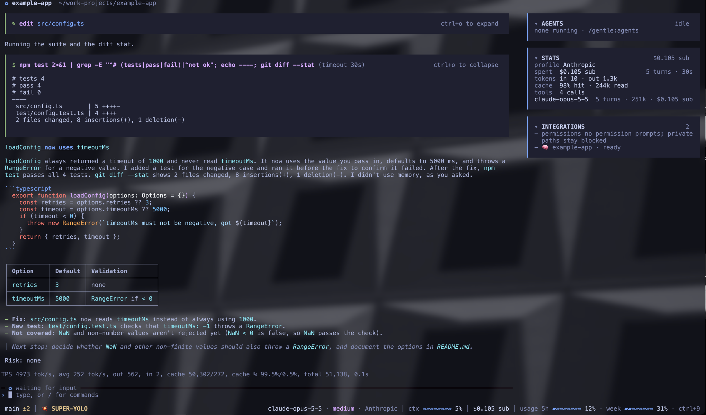
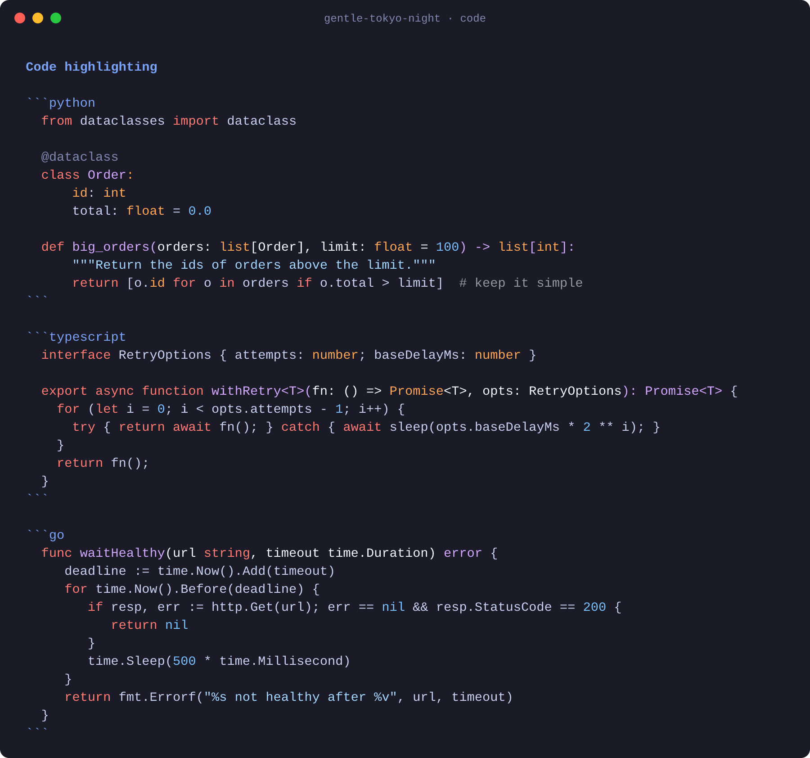

# gentle-tokyo-night

*[Spanish](README.es.md)*

A dark theme for [Gentle Shell](https://github.com/Gentleman-Programming/gentle-shell) and [Pi](https://github.com/earendil-works/pi): a Tokyo Night interface with GitHub's dark code colors.

- **Interface:** Tokyo Night style, with deep blue-grey cards, a lavender accent, and soft green, red and yellow for status.
- **Code:** the syntax colors GitHub uses in dark mode. Coral keywords, light-blue strings, lilac function names and orange types.
- **Tool headers:** lilac (`#D2A8FF`) instead of orange, so commands such as `$ npm test`, `read` or `edit` stand out without shouting.

## Screenshots

**Gentle Shell:** a session with tool cards, the sidebar and a markdown reply.



**Code blocks:** Python, TypeScript and Go.



The Gentle Shell screenshot is a real session on a demo project, in a terminal with a translucent background. The code screenshot uses sample content.

## Install

### Gentle Shell

1. Download the theme into Gentle Shell's theme folder:

   ```bash
   curl -fsSL -o ~/.gentle-shell/agent/themes/gentle-tokyo-night.json \
     https://raw.githubusercontent.com/restevean/gentle-tokyo-night/main/themes/gentle-tokyo-night.json
   ```

2. Select it in `/settings`, or set it in `~/.gentle-shell/agent/settings.json`:

   ```json
   { "theme": "gentle-tokyo-night" }
   ```

3. Restart Gentle Shell.

### Pi

The same steps, using Pi's folders instead: `~/.pi/agent/themes/` and `~/.pi/agent/settings.json`.

> Gentle Shell does not read `~/.pi/agent/themes/`. If you use both, copy the file to both folders.

### Terminal background

Pi themes do not paint the background: Gentle Shell and Pi use your terminal's. For the look in the screenshots, set your terminal profile background to `#1A1B26`.

## Palette

### Code

| Role | Color | Examples |
|---|---|---|
| Keywords | `#FF7B72` | `def`, `if`, `return`, `func` |
| Operators | `#FF7B72` | `=`, `<`, `+`, `&&` |
| Strings | `#A5D6FF` | `"hello"`, f-strings, template literals |
| Numbers and literals | `#79C0FF` | `42`, `0.5`, `nil` |
| Function names | `#D2A8FF` | the name in `def big_orders(...)` |
| Types and built-ins | `#FFA657` | `int`, `Promise`, `string`, `len` |
| Comments | `#9198A1` | `# note`, `// note` |
| Variables and punctuation | `#F0F6FC` | `total`, `( )`, `,` |

These values come from GitHub's dark syntax colors, as published in [github-markdown-css](https://github.com/sindresorhus/github-markdown-css).

### Interface

| Role | Color |
|---|---|
| Background (recommended terminal background) | `#1A1B26` |
| Text | `#C8D0F0` |
| Accent, headings | `#7AA2F7` |
| Links | `#8EA6F8` |
| Inline code | `#89DCEB` |
| Tool cards | `#1F2030` |
| Tool headers | `#D2A8FF` |
| Success, added lines | `#A6D189` |
| Error, removed lines | `#BE646A` |
| Warning | `#E5C890` |
| Muted text | `#8088B0` |

## Credits

- The interface is inspired by [Tokyo Night](https://github.com/enkia/tokyo-night-vscode-theme) by enkia.
- The code colors come from GitHub's dark syntax colors.

## License

[MIT](LICENSE)
